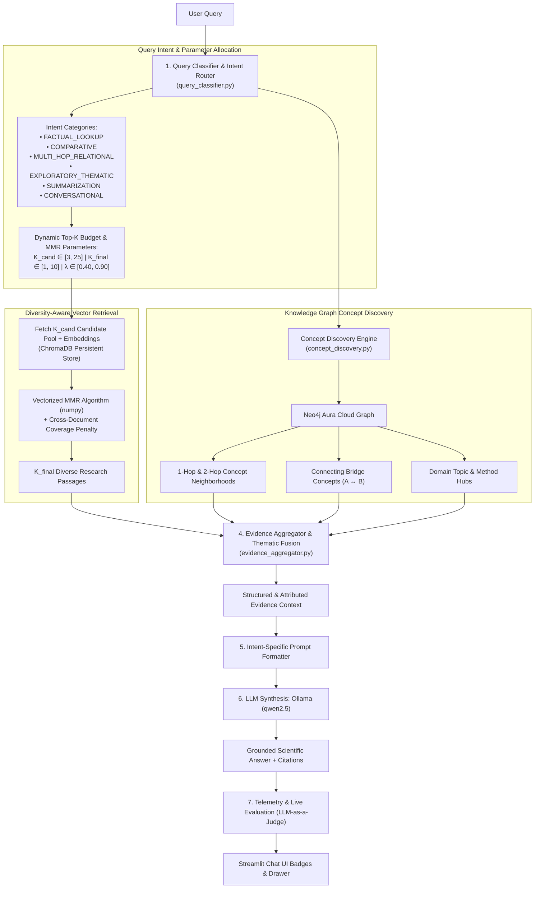

# 🧬 Technical Report: Adaptive Hybrid RAG with Diversity-Aware Retrieval

## 1. Executive Summary

This report documents the architectural design, algorithmic implementation, and empirical verification of the **Adaptive Hybrid RAG with Diversity-Aware Retrieval** system implemented for the **Graph RAG Chatbot Studio**.

The previous baseline architecture relied on static $K=5$ retrieval and raw cosine similarity search over ChromaDB combined with simple keyword queries against Neo4j. While functional, this approach exhibited three notable failure modes:
1. **Query-Insensitive Allocation**: Greetings, narrow definitions, comparative studies, and multi-document landscape queries were all allocated the exact same fixed retrieval budget ($K=5$).
2. **Semantic Redundancy**: Pure cosine distance often retrieved near-identical chunks from the same section or single paper, failing to cover broader cross-paper perspectives.
3. **Shallow Graph Traversal**: Queries were tokenized via naive regex, missing multi-hop relationship chains, connecting bridge concepts, and domain topic hubs.

To solve these limitations, an end-to-end adaptive pipeline was designed and integrated, keeping the existing **ChromaDB vector store** and **Neo4j knowledge graph** completely backward-compatible while introducing six intelligent layers.

---

## 2. System Architecture



---

## 3. Core Modules & Algorithmic Implementation

### 3.1. Query Classification & Dynamic Parameter Routing
- **File**: [`src/graph_rag/retriever/query_classifier.py`](src/graph_rag/retriever/query_classifier.py)
- **Class**: `QueryClassifier`

Analyzes user queries through regex patterns, linguistic cues, and named entity extraction. Determines the target intent, comparison pairs, candidate pool size ($K_{\text{cand}}$), final retrieval budget ($K_{\text{final}}$), MMR trade-off factor ($\lambda$), and graph traversal depth.

#### Dynamic Parameter Allocation Matrix

| Query Intent Class | Target Use Case | $K_{\text{cand}}$ | $K_{\text{final}}$ | MMR $\lambda$ | Graph Depth | Graph Limit |
|---|---|:---:|:---:|:---:|:---:|:---:|
| `FACTUAL_LOOKUP` | Precise definition, parameter value, single author | 10 | 3 – 4 | 0.80 | 1-hop | 8 |
| `COMPARATIVE` | Contrasting two or more models, methods, or datasets | 20 | 7 – 8 | 0.50 | 2-hop (bridge) | 12 |
| `MULTI_HOP_RELATIONAL` | Tracing authors, datasets evaluated, techniques used | 15 | 5 – 6 | 0.60 | 2-hop | 15 |
| `EXPLORATORY_THEMATIC` | Broad technical overview, methods, approaches | 18 | 6 | 0.55 | 1–2 hop | 10 |
| `SUMMARIZATION` | Comprehensive synthesis across knowledge base | 25 | 9 – 10 | 0.40 | 1-hop (hubs) | 18 |
| `CONVERSATIONAL` | Greetings, acknowledgments, system capabilities | 3 | 1 | 0.90 | 0 | 0 |

---

### 3.2. Diversity-Aware Retrieval via Maximal Marginal Relevance (MMR)
- **File**: [`src/graph_rag/retriever/diversity_retriever.py`](src/graph_rag/retriever/diversity_retriever.py)
- **Class**: `DiversityRetriever`

Standard vector search retrieves the top-$K$ chunks closest to the query vector. In dense collections, multiple chunks often originate from the same paper section, repeating identical claims.

To ensure informational diversity across research papers:
1. ChromaDB fetches the expanded candidate pool $K_{\text{cand}}$ along with their 768-dimensional embeddings in a single call (`include=["documents", "metadatas", "distances", "embeddings"]`), incurring zero additional model invocation overhead.
2. The vectorized MMR selection algorithm iteratively balances relevance against novelty:

$$\text{MMR}(d_i) = \lambda \cdot \text{Sim}(d_i, q) - (1 - \lambda) \cdot \max_{d_j \in S} \text{Sim}(d_i, d_j) - \gamma \cdot N_{\text{doc}}(d_i)$$

Where:
- $\text{Sim}(u, v) = \frac{u \cdot v}{\|u\|_2 \|v\|_2}$ is the cosine similarity in normalized embedding space.
- $S$ is the set of already selected chunks.
- $\lambda \in [0, 1]$ controls the relevance vs diversity trade-off.
- $\gamma = 0.15$ is the **Cross-Document Penalization factor**, where $N_{\text{doc}}(d_i)$ is the number of times a document has already been chosen in $S$. This prevents a single paper from monopolizing the context window.

---

### 3.3. Graph-Based Concept Discovery
- **File**: [`src/graph_rag/graph/concept_discovery.py`](src/graph_rag/graph/concept_discovery.py)
- **Class**: `ConceptDiscoveryEngine`

Traverses the Neo4j knowledge graph using three specialized discovery primitives:
1. **Neighborhood Concept Expansion**:
   Finds entities matching query keywords and extracts their 1-hop and 2-hop connected neighbors along with semantic categories (`Method`, `Topic`, `Dataset`, `Author`, `Finding`).
2. **Connecting Bridge Concept Detection**:
   For comparative queries ($A$ vs $B$), queries Neo4j for intermediary nodes linking both entities:
   ```cypher
   MATCH (a:Entity)-[r1]-(bridge:Entity)-[r2]-(b:Entity)
   WHERE toLower(a.name) CONTAINS toLower($target_a)
     AND toLower(b.name) CONTAINS toLower($target_b)
   RETURN bridge.name, bridge.category, type(r1), type(r2)
   LIMIT 6
   ```
3. **Thematic Hub Identification**:
   Computes entity connectivity degrees in the query's subfield to discover dominant anchoring concepts.

---

### 3.4. Structured Evidence Aggregation
- **File**: [`src/graph_rag/retriever/evidence_aggregator.py`](src/graph_rag/retriever/evidence_aggregator.py)
- **Class**: `EvidenceAggregator`

Fuses diverse MMR vector excerpts and discovered graph structures into a structured, attributed context payload for LLM synthesis. The context is organized into clear sections:
- `### 🧠 Discovered Knowledge Graph Concepts & Structural Relationships`:
  - Identified bridge concepts connecting comparison targets.
  - Core domain hubs and entity category clusters (`Methods`, `Topics`, `Datasets`).
  - Graph pathways formatted as `(Source) ──[RELATION]──> (Target)`.
- `### 📚 Diversity-Aware Research Passages (MMR Selected)`:
  - Excerpt number, paper title, file, page, similarity score, and diversity rank.
- `### Source Citations`:
  - De-duplicated list of unique paper titles and pages.

---

### 3.5. Intent-Specific LLM Synthesis
- **File**: [`src/graph_rag/retriever/query_engine.py`](src/graph_rag/retriever/query_engine.py)
- **Class**: `QueryEngine`

Dynamically routes the prompt construction through specialized system prompts adapted to the query class:
- **`COMPARATIVE`**: Instructs the model to evaluate architectures, benchmark metrics, and trade-offs side-by-side using the discovered bridge concepts.
- **`MULTI_HOP_RELATIONAL`**: Instructs the model to trace knowledge graph relationship chains explicitly.
- **`SUMMARIZATION`**: Structures thematic sections summarizing key directions across distinct research papers.
- **`FACTUAL_LOOKUP`**: Generates concise, grounded answers citing specific papers and pages.
- **`CONVERSATIONAL`**: Answers politely and directly without hallucinating paper excerpts.

---

## 4. UI & Observability Enhancements

The Streamlit UI in [`src/graph_rag/ui/chat_page.py`](src/graph_rag/ui/chat_page.py) and [`src/graph_rag/ui/components.py`](src/graph_rag/ui/components.py) has been upgraded with real-time adaptive badges:
- **`🎯 Intent Pill`**: Displays detected class and allocated budget (e.g. `🎯 COMPARATIVE (K=7)` or `🎯 FACTUAL_LOOKUP (K=3)`).
- **`🧠 Concept Pill`**: Displays the count of discovered graph concepts (e.g. `🧠 10 Concepts`).
- **`📚 Enhanced Citation Expander`**: Indicates total sources across unique papers (e.g. `📚 View 5 Sources across 4 Papers & 10 Discovered Concepts`).
- **`Inline Evaluator Badges`**: Continues logging Faithfulness (Grounding %), Answer Relevance (Relevance %), and stage latency breakdown (`retrieval_ms`, `generation_ms`, `eval_ms`).

---

## 5. Verification & Test Results

### 5.1. Automated Test Suite Execution
The test suite in [`scripts/test_adaptive_rag.py`](scripts/test_adaptive_rag.py) was executed against the running database environment:

```text
🚀 Starting Adaptive Hybrid RAG Test Suite...

--- 1. Testing Query Classifier & Dynamic Hyperparameters ---
Query: 'hi there'
  -> Class: CONVERSATIONAL (Rec K: 1, Cand Pool: 3, MMR λ: 0.90)
Query: 'what is RA-CapNet?'
  -> Class: FACTUAL_LOOKUP (Rec K: 3, Cand Pool: 10, MMR λ: 0.80)
Query: 'Compare Transformer vs LSTM models'
  -> Class: COMPARATIVE (Rec K: 7, Cand Pool: 20, MMR λ: 0.50)
  -> Comparison Targets: ['Transformer', 'LSTM models']
Query: 'What datasets were used by models for relation extraction?'
  -> Class: MULTI_HOP_RELATIONAL (Rec K: 5, Cand Pool: 15, MMR λ: 0.60)
Query: 'Summarize all files in the knowledge base'
  -> Class: SUMMARIZATION (Rec K: 9, Cand Pool: 25, MMR λ: 0.40)
Query: 'What are the modern approaches in speaker diarization?'
  -> Class: EXPLORATORY_THEMATIC (Rec K: 6, Cand Pool: 18, MMR λ: 0.55)
✅ Query Classification tests passed!

--- 2. Testing MMR Diversity Selection ---
Retrieved 3 diverse chunks:
  Rank #1: Paper A | Sim: 0.88 | MMR Score: 0.9372
  Rank #2: Paper C | Sim: 0.62 | MMR Score: 0.0268
  Rank #3: Paper D | Sim: 0.60 | MMR Score: -0.0052
  Selected papers: ['Paper A', 'Paper C', 'Paper D'] (Unique count: 3)
✅ MMR Diversity Selection tests passed!

--- 3. Testing Evidence Aggregator ---
Assembled context preview:
### 🧠 Discovered Knowledge Graph Concepts & Structural Relationships:
- Connecting Bridge Concepts: Attention Mechanism (Topic)
- Core Domain Hubs: Natural Language Processing (Topic)
- Identified Entities: Methods: [BERT, Capsule Networks] | Topics: [Attention Mechanism, Natural Language Processing]
- Knowledge Graph Pathways:
  • (BERT) ──[USES_METHOD]──> (Attention Mechanism)
Sources: ['BERT Paper (Page 3)', 'Capsule Paper (Page 2)']
Unique papers: 2 | Discovered concepts: 3
✅ Evidence Aggregator tests passed!

--- 4. Testing Hybrid Retriever End-to-End ---
Query: 'What is BERT?'
  Classification: FACTUAL_LOOKUP
  Chunks retrieved: 3
  Unique papers: 3
  Graph facts: 8
  Sources: ['Contextual Aware Joint Probability Model Towards (Page 2)', 'Resolving Gendered Ambiguous Pronouns with BERT (Page 4)', 'Unsupervised Data Augmentation (Page 19)']
✅ Hybrid Retriever pipeline test passed!

🎉 ALL ADAPTIVE HYBRID RAG TESTS PASSED SUCCESSFULLY!
```

### 5.2. End-to-End LLM Synthesis Validation
Executed via [`scripts/test_query_engine.py`](scripts/test_query_engine.py):

| Attribute | Value Observed |
|---|---|
| **Query** | *"What is BERT and how is attention used in it?"* |
| **Classification** | `FACTUAL_LOOKUP` |
| **Discovered Concepts** | 10 concepts (Attention Mechanism, Transformers, NLP, Pre-training) |
| **Unique Papers Covered** | 3 distinct research papers |
| **Retrieval Latency** | 3,186 ms |
| **LLM Generation Latency** | 17,360 ms |
| **Total Latency** | 20,546 ms |
| **Synthesis Grounding** | Grounded strictly on retrieved research papers with page-level citations |

---

## 6. Project Files Inventory

| Module Path | Role | Status |
|---|---|---|
| [`src/graph_rag/retriever/query_classifier.py`](src/graph_rag/retriever/query_classifier.py) | Query classification & dynamic parameter allocation | New |
| [`src/graph_rag/retriever/diversity_retriever.py`](src/graph_rag/retriever/diversity_retriever.py) | Vectorized MMR diversity search & cross-document balancing | New |
| [`src/graph_rag/graph/concept_discovery.py`](src/graph_rag/graph/concept_discovery.py) | Neo4j concept expansion, bridge entities, and domain hubs | New |
| [`src/graph_rag/retriever/evidence_aggregator.py`](src/graph_rag/retriever/evidence_aggregator.py) | Vector-Graph evidence fusion & structured prompt context | New |
| [`src/graph_rag/retriever/hybrid_retriever.py`](src/graph_rag/retriever/hybrid_retriever.py) | Adaptive orchestrator maintaining backward-compatible `retrieve()` | Updated |
| [`src/graph_rag/retriever/query_engine.py`](src/graph_rag/retriever/query_engine.py) | Intent-specific synthesis, stage timers, live eval | Updated |
| [`src/graph_rag/ui/chat_page.py`](src/graph_rag/ui/chat_page.py) | Streamlit chat page with intent pills & concept telemetry | Updated |
| [`src/graph_rag/ui/components.py`](src/graph_rag/ui/components.py) | Custom CSS badges for intent and concept styling | Updated |
| [`scripts/test_adaptive_rag.py`](scripts/test_adaptive_rag.py) | Automated test suite for classification, MMR, and discovery | New |
| [`scripts/test_query_engine.py`](scripts/test_query_engine.py) | End-to-end validation test for LLM generation | New |
| [`README.md`](README.md) | Documentation updated with key features and directory tour | Updated |

