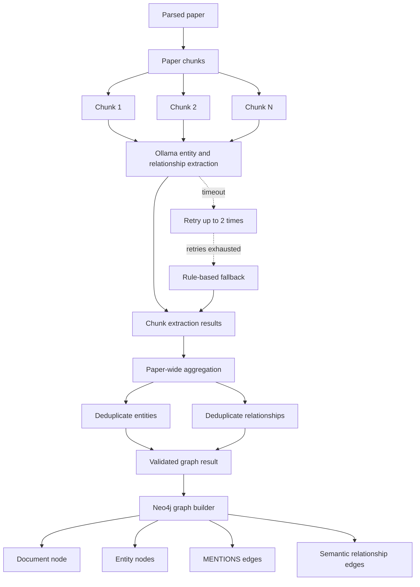

# Graph Knowledge Building

The system builds a paper-wide knowledge graph during document ingestion.

## 1. Paper parsing and chunking

Each paper is parsed into a `ParsedDocument`, then split into text chunks. Every
chunk is processed for graph extraction. The chunks are also embedded into
ChromaDB for vector retrieval.

The paper-wide extraction is implemented in
[`IngestionPipeline._extract_paper_graph`](src/graph_rag/ingestion/pipeline.py).

## 2. LLM entity extraction

Every chunk is sent to the local Ollama LLM with an extraction prompt. The LLM
identifies scientific entities in the text.

Allowed entity categories are:

- `Topic`: research areas or subfields
- `Method`: models, algorithms, architectures, or techniques
- `Dataset`: benchmarks or datasets
- `Author`: researchers mentioned in the text
- `Finding`: important conclusions or insights

Example response:

```json
{
  "entities": [
    {
      "name": "BERT",
      "category": "Method",
      "description": "Transformer-based language model"
    },
    {
      "name": "SQuAD",
      "category": "Dataset",
      "description": "Question answering benchmark"
    }
  ]
}
```

The extraction prompt and validation logic are in
[`entity_extractor.py`](src/graph_rag/graph/entity_extractor.py).

## 3. LLM relationship extraction

The LLM also determines semantic relationships between entities by interpreting
the meaning of the paper text.

Supported relationship types are:

- `PROPOSES`
- `EVALUATES_ON`
- `USES_METHOD`
- `PART_OF_TOPIC`
- `RELATED_TO`

For example, the sentence:

```text
We evaluate BERT on the SQuAD dataset.
```

can produce:

```json
{
  "source": "BERT",
  "target": "SQuAD",
  "relation_type": "EVALUATES_ON",
  "description": "BERT is evaluated on the SQuAD dataset"
}
```

This becomes the Neo4j relationship:

```cypher
(:Entity {name: "BERT"})-[:EVALUATES_ON]->(:Entity {name: "SQuAD"})
```

## 4. Merging the complete paper graph

The extraction results from all chunks are combined into one paper-wide graph.

Entities are deduplicated using:

```text
entity name + entity category
```

Relationships are deduplicated using:

```text
source + target + relationship type
```

If duplicate entities have different descriptions, the longest description is
kept. Relationships are retained only when both endpoint entities exist in the
merged entity set.

## 5. Neo4j graph structure

Each paper is stored as a `Document` node:

```cypher
(:Document {
  name,
  title,
  topic,
  source
})
```

Each extracted entity is stored as an `Entity` node:

```cypher
(:Entity {
  name,
  category,
  description
})
```

The paper is connected to its entities with `MENTIONS` relationships:

```cypher
(:Document)-[:MENTIONS]->(:Entity)
```

The semantic relationships extracted by the LLM connect entity nodes:

```cypher
(:Entity)-[:USES_METHOD]->(:Entity)
(:Entity)-[:EVALUATES_ON]->(:Entity)
(:Entity)-[:PART_OF_TOPIC]->(:Entity)
```

Neo4j write and merge behavior is implemented in
[`graph_builder.py`](src/graph_rag/graph/graph_builder.py).

## 6. LLM timeout and fallback behavior

Ollama requests use a 180-second timeout and retry timed-out requests up to two
times. If all attempts fail, the extractor uses a rule-based fallback.

The fallback:

- Adds the document title as a method-like entity.
- Detects capitalized acronyms such as `BERT`, `CNN`, `LSTM`, `ASR`, and `NLP`.
- Creates basic `USES_METHOD` relationships.

This fallback allows ingestion to continue, but it may produce fewer entities
and relationships than the LLM extraction.

## 7. End-to-end graph flow

```text
Paper
  |
  v
Parse document
  |
  v
Split into chunks
  |
  v
Send every chunk to Ollama
  |
  v
Extract entities and relationships
  |
  v
Merge and deduplicate paper-wide results
  |
  v
Create Document and Entity nodes in Neo4j
  |
  v
Create MENTIONS and semantic relationships
```

## 8. Architecture visualization



### Component responsibilities

| Graph component | Responsibility |
|---|---|
| Paper chunks | The complete paper sections sent for graph extraction |
| Ollama LLM | Identifies entities and semantic relationships in each chunk |
| Graph aggregator | Combines results from every chunk in the paper |
| Entity deduplication | Merges entities by normalized name and category |
| Relationship deduplication | Merges relationships by source, target, and type |
| Neo4j graph builder | Writes the final nodes and relationships |
| Rule-based fallback | Keeps graph extraction running after repeated LLM timeouts |

To rebuild the graph for already-ingested papers without duplicating vector
embeddings, run:

```powershell
uv run python scripts/ingest.py --rebuild-graph
```
