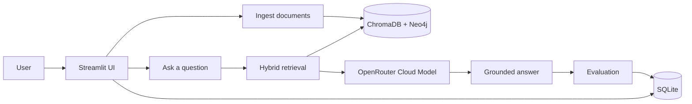
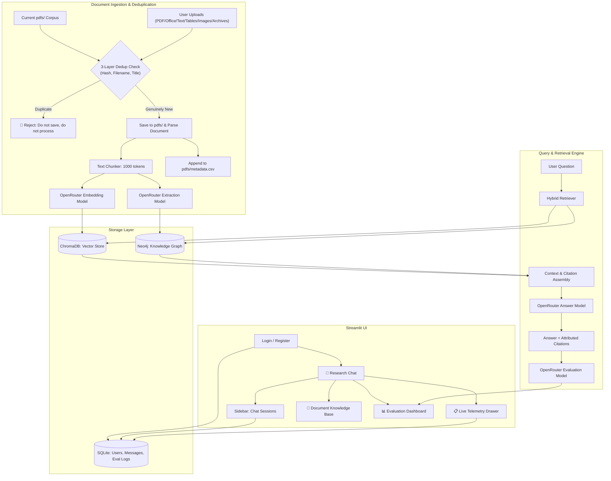
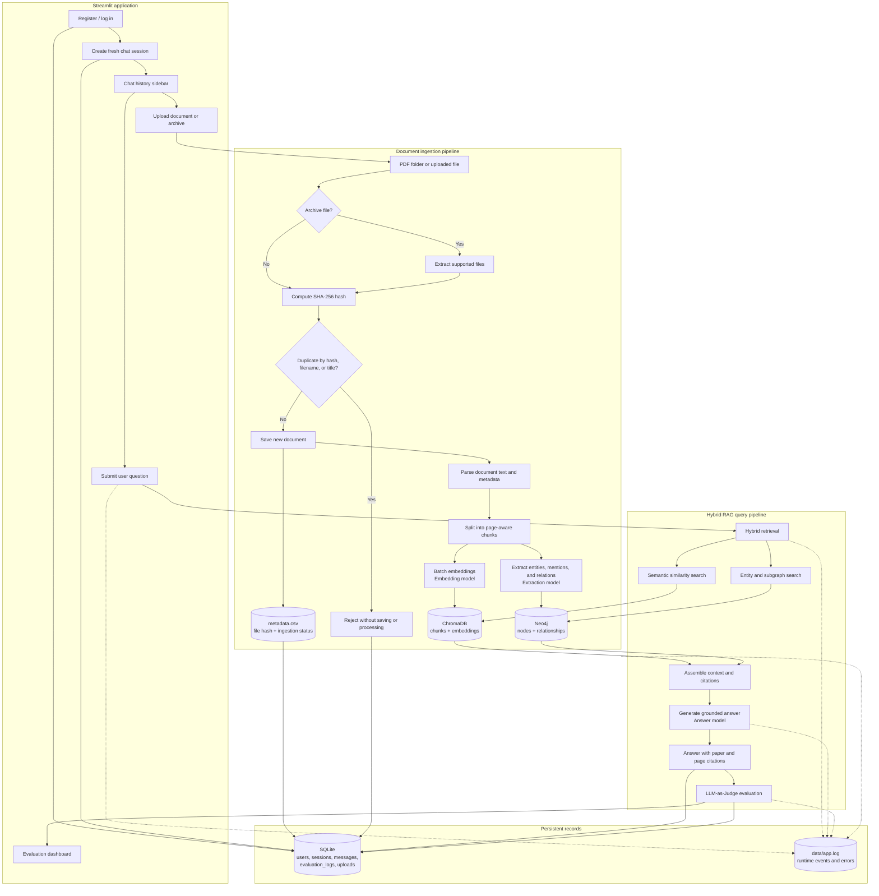

# 🧬 Graph RAG Chatbot Studio

> A scientific research assistant powered by **Hybrid Graph RAG** (Knowledge Graph + Vector Embeddings), **Neo4j**, and configurable cloud models through **OpenRouter**. Includes evidence-backed graph construction, user authentication, persistent chat history, strict document deduplication, and live RAG evaluation.

---

## 🌟 Key Features

- **Adaptive Hybrid RAG with Diversity-Aware Retrieval**:
  - **Query Classification & Intent Routing**: Categorizes queries (`FACTUAL_LOOKUP`, `COMPARATIVE`, `MULTI_HOP_RELATIONAL`, `EXPLORATORY_THEMATIC`, `SUMMARIZATION`, `CONVERSATIONAL`) to dynamically adapt retrieval strategies.
  - **Dynamic Top-K**: Automatically budgets candidate pool and final chunk counts based on question complexity.
  - **Diversity-Aware MMR (Maximal Marginal Relevance)**: Eliminates redundant passages across candidate embeddings while enforcing cross-document coverage across distinct papers.
  - **Graph-Based Concept Discovery**: Traverses **Neo4j** for multi-hop entity neighborhoods, bridge concepts between comparative targets, and central thematic hubs.
  - **Structured Evidence Aggregation**: Fuses MMR vector excerpts, graph pathways, and cross-references into an attributed context payload.
  - **Adaptive LLM Synthesis**: Tailors cloud-model prompt templates to the query intent (e.g. comparative matrices, relationship chains, thematic summaries).
- **Task-Specific Cloud Models**: Extraction, answer generation, evaluation, and embeddings each use an explicit OpenRouter model selected in `.env`; credentials are never committed.
- **Evidence-First Graph**: Documents, topics, subtopics, and canonical entities are stored in Neo4j; text chunks and entity vectors remain in ChromaDB. Evidence, mention provenance, and non-blocking diagnostics are stored in SQLite. Neo4j does not create Chunk or Mention nodes, and relationship types remain open-ended properties on generic `RELATION` edges.
- **Automatic Open-Schema Ingestion**: LangChain coordinates document-level graph extraction. spaCy supplies sentence, token, NER, dependency, and noun-phrase candidates only; evidence- and confidence-validated LLM results determine graph facts. Entity/type normalization, duplicate resolution, topic hierarchy, and ambiguous-case diagnostics require no routine manual review.
- **Dual Data Sources**:
  1. **Initial Repository**: The current research corpus placed in the `pdfs/` folder.
  2. **Dynamic UI Uploads**: Users can upload new papers directly in the Streamlit UI.
- **Strict Deduplication & Metadata Protection**:
  - `pdfs/metadata.csv` acts as the single source of truth and catalog.
  - Checks in-memory (SHA-256 hash, filename, and paper title) **before saving anything to disk**.
  - **If a file already exists in our data**: It is **NOT saved** to disk and **NO backend processing** (no chunking, embedding, or graph building) is performed.
- **Multi-Format & Archive Ingestion**: Supports PDF, Word, PowerPoint, text, Markdown, CSV, Excel, JSON, Parquet, and common image formats, with automatic unpacking of `.zip`, `.rar`, `.7z`, and `.tar.gz`.
- **User Authentication**: Secure registration and login powered by `bcrypt` password hashing and `JWT` session tokens.
- **Persistent Chat History**: Multi-session conversation management stored in SQLite with expandable paper citations and page numbers.
- **Live RAG Evaluation**: Real-time scoring using **LLM-as-a-Judge** (Faithfulness, Answer Relevance, Context Relevance) plus millisecond latency telemetry across retrieval, generation, and evaluation stages. Failed or invalid judge responses are shown as unavailable rather than fabricated scores.

---

## 🏗️ Architecture & Pipeline



The detailed implementation flow is :

<details>
<summary>Detailed architecture diagram</summary>



---

## 🔄 End-to-End Pipeline Visualization

The following flow shows how documents and user questions move through the
system, including persistence, evaluation, and runtime observability:



### Pipeline stages

1. **Authentication and sessions**: A successful login creates a new empty chat
   session. Existing sessions remain persisted and available in the sidebar.
2. **Ingestion**: Files are checked for duplicates before parsing or storage.
   New documents are parsed, chunked, embedded into ChromaDB, and represented
   as entities and relationships in Neo4j. Structured source rows are retained
   in SQLite; page/OCR provenance and detected file type, MIME type, and
   language are recorded as well.
   LangChain supplies the model clients, text splitter, Chroma integration,
   structured extraction chain, and bounded parallel retrieval.
3. **Hybrid retrieval**: Each question searches both ChromaDB for relevant text
   and Neo4j for connected graph facts. The results are merged with citations.
4. **Answer generation**: The configured cloud model generates an answer grounded in the assembled
   context and the relevant paper/page sources.
5. **Evaluation and observability**: Faithfulness, answer relevance, context
   relevance, and stage latency are stored in SQLite. Runtime events are also
   written to `data/app.log` and the Streamlit terminal.

</details>

## 📊 How It Works (In Simple Words)

Scanned PDFs and image inputs use local Tesseract OCR. Install Tesseract with
both the English (`eng`) and Arabic (`ara`) language data, and ensure the
executable is available on `PATH`. OCR language and PDF render DPI are
configurable with `OCR_LANGUAGES` and `OCR_DPI`; no OCR service credentials are
required.

1. **Initial Startup (Mode A)**:
   The system scans the current `pdfs/` corpus and checks `pdfs/metadata.csv`. New papers are parsed, split into overlapping chunks, embedded with the configured cloud embedding model, and written to a versioned ChromaDB collection and the evidence-first Neo4j graph.

2. **When a User Uploads a File (Mode B)**:
   - When a user uploads a document or archive via the UI, the system calculates its SHA-256 fingerprint in memory.
   - It cross-references `metadata.csv` for content hash, filename, and paper title.
   - **If a duplicate is found**: The system **immediately rejects** the file. It is **never saved to disk**, and **no backend compute is spent**. The user receives an informative warning showing the matching document title.
   - **If the file is new**: It is saved to `pdfs/`, processed into ChromaDB and Neo4j, and registered into `metadata.csv`.

3. **When a User Asks a Question**:
   - The query searches ChromaDB for semantically similar paragraphs.
   - It simultaneously queries Neo4j for connected entities and relationships.
   - Both results are combined into a structured prompt with source citations.
   - The configured answer model responds with explicit references to paper titles and page numbers.
   - An automated judge evaluates the response's faithfulness, relevance, and latency live.

---

## 🚀 Step-by-Step Setup Guide

Follow these commands to configure and run the project from start to finish.

### 1. Prerequisites
- **Python**: Version `3.12`
- **UV Package Manager**: Installed on your system (`pip install uv` or `curl -LsSf https://astral.sh/uv/install.sh | sh`)
- **OpenRouter**: An API key with access to the selected chat and embedding models.
- **Neo4j**: A clean local, Aura, or managed instance for the redesigned graph.

### 2. Choose Cloud Models
Choose separate OpenRouter models for structured extraction, final answers,
evaluation, and embeddings. Put their exact model IDs in the local `.env` file;
model selection is configuration and does not require source-code changes.

### 3. Run Neo4j (Optional / Recommended)
If you have Docker installed, start Neo4j with one command:
```bash
docker run -d --name neo4j-graph \
  -p 7474:7474 -p 7687:7687 \
  -e NEO4J_AUTH=neo4j/password123 \
  neo4j:latest
```
*(Note: If Neo4j is offline, the system automatically falls back to dense vector search via ChromaDB).*

### 4. Install Project Dependencies
Using UV, install all dependencies locked in `pyproject.toml`:
```bash
uv sync
```

### 5. Configure Environment Variables
Copy `.env.example` to `.env` and verify settings:
```bash
cp .env.example .env
```
Key configuration items in `.env`:
```env
MODEL_API_BASE_URL=https://openrouter.ai/api/v1
OPENROUTER_API_KEY=replace-with-your-key
OPENROUTER_EXTRACTION_MODEL=anthropic/claude-haiku-5.5
OPENROUTER_CHAT_MODEL=google/gemini-3.8-flash
OPENROUTER_EVAL_MODEL=anthropic/claude-haiku-5.5
OPENROUTER_EMBED_MODEL=qwen/qwen3-embedding-8b
EMBEDDING_DIMENSIONS=4096
CHROMA_COLLECTION_NAME=research_papers_graph_v2
DATASET_ID=research-v2

NEO4J_URI=neo4j+s://xxxxxxxx.databases.neo4j.io
NEO4J_USER=
NEO4J_PASSWORD=

PDF_DIR=pdfs
METADATA_FILE=pdfs/metadata.csv
DATA_DIR=data
LOG_LEVEL=INFO
APP_LOG_FILE=data/app.log
```

Runtime logs are written to `data/app.log` and also displayed in the terminal.
The file rotates at 5 MB and keeps up to three backup files.

### 6. Initialize SQLite Database
Initialize all database tables (users, chat sessions, messages, evaluation logs):
```bash
uv run python scripts/setup_db.py
```

### 7. Test External Connections
Verify the OpenRouter model IDs and Neo4j credentials without processing PDFs
or running paid inference:
```bash
uv run python scripts/test_connections.py
```
To make minimal paid calls that also verify credits and model permissions:
```bash
uv run python scripts/test_connections.py --deep
```

### 8. Run Batch Ingestion
Add supported documents to `pdfs/` and run:
```bash
uv run python scripts/ingest.py
```
*Tip: Unchanged or renamed duplicate content is skipped; new and changed documents are processed automatically.*

Graph extraction runs once per document (splitting only when the model context
limit requires it) and is cached under
`data/extraction_cache/`. A graph rebuild reuses that cache and does not call
the extraction model again. Rebuilds require a complete, compatible cache:
```bash
uv run python scripts/ingest.py --limit 3 --rebuild-graph
```
If the operating system blocks spaCy's native runtime, ingestion logs a warning
and uses a deterministic lexical fallback for sentence boundaries and token
budgeting; spaCy NER, dependency, and noun-phrase candidates are unavailable
until that runtime is allowed to load. Missing configured spaCy models remain
an explicit error.
Only use `--refresh-extraction` when a deliberately fresh extraction is
required. Cache entries are versioned by document content, model, prompt,
extraction pipeline, and normalization versions. Model usage is recorded per API
request with role, outcome, latency, retry/cache status, token counts,
request/run IDs, and the pricing rates used. Costs are calculated
locally without an LLM:

```text
cost = (input_tokens * input_USD_per_million
      + output_tokens * output_USD_per_million) / 1,000,000
```

The versioned rate card is in `src/graph_rag/llm/pricing.py`. It currently
records Gemma 4 31B Free at $0, Qwen3 Embedding 8B at $0.01 per million input
tokens, and Qwen3.7 Flash at $0.03/$0.13 per million input/output tokens.
Qwen3.7 Flash uses its published higher tiers at prompts of 32K and 256K
tokens.
Token counts come from API usage metadata; the provider-reported cost, when
present, is stored separately for comparison. If a model is not in the local
rate card or token counts are unavailable for a paid model, the calculated cost
is explicitly marked unknown rather than guessed. Update the rate card when
model IDs or provider prices change. Pricing references: [OpenRouter models
API](https://openrouter.ai/api/v1/models) and [embedding models
API](https://openrouter.ai/api/v1/embeddings/models).

The CLI prints per-run calculated cost, and recent request details appear in
the application sidebar. Live evaluation is disabled by default during
development to avoid extra judge-model calls.

To migrate existing paper metadata to the hierarchical Top-level Topic →
Subtopic model without re-embedding documents or calling an LLM:
```bash
uv run python scripts/rebuild_topic_hierarchy.py
```

### 9. Launch the Streamlit Web Application
Start the interactive UI directly from the project root:
```bash
uv run streamlit run app.py
```
Open your browser at `http://localhost:8501`.

---

## 📁 Project Directory Tour

```
graph-rag/
├── app.py                        # Main Streamlit application entry point
├── .env                          # Local secrets & settings (gitignored)
├── .env.example                  # Template configuration for team members
├── pyproject.toml                # UV project configuration and dependencies
├── README.md                     # Documentation and architecture guide
├── pdfs/                         # Knowledge base documents
│   ├── metadata.csv              # Single source of truth catalog & registry
│   └── supported documents       # PDF, Office, text, tables, images, Parquet
│
├── scripts/
│   ├── setup_db.py               # Initializes SQLite tables
│   ├── ingest.py                 # CLI batch ingestion for pdfs/ folder
│   ├── test_dedup.py             # Deduplication verification test
│   ├── test_adaptive_rag.py      # Adaptive Hybrid RAG & MMR test suite
│   ├── test_file_formats.py      # Isolated format and graph-safety tests
│   └── test_query_engine.py      # End-to-end query engine validation
│
└── src/graph_rag/
    ├── config.py                 # Loads and validates .env settings
    │
    ├── database/
    │   └── db.py                 # SQLite connection & schema definitions
    │
    ├── auth/
    │   ├── models.py             # User dataclass
    │   ├── jwt_handler.py        # Token generation & verification
    │   └── auth_service.py       # bcrypt hashing & login/register logic
    │
    ├── chat/
    │   ├── models.py             # ChatSession & ChatMessage dataclasses
    │   └── chat_service.py       # Session CRUD & message history
    │
    ├── ingestion/
    │   ├── metadata_manager.py   # Thread-safe read/append for metadata.csv
    │   ├── dedup_checker.py      # 3-layer in-memory duplicate detector
    │   ├── pdf_parser.py         # PyMuPDF text, OCR routing, and table extraction
    │   ├── docx_parser.py        # Word text, table, and image extraction
    │   ├── pptx_parser.py        # PowerPoint text, table, and image extraction
    │   ├── image_parser.py       # Standalone image OCR
    │   ├── ocr.py                # Replaceable OCR provider and Tesseract adapter
    │   ├── archive_handler.py    # Safe ZIP/RAR/7z/tar unpacker
    │   ├── file_handler.py       # Extensible format router
    │   ├── structured_parser.py  # CSV, XLSX, JSON, and Parquet tables
    │   ├── chunker.py            # 1000-token chunker with overlap (150 tokens)
    │   └── pipeline.py           # Ingestion orchestrator (batch & upload)
    │
    ├── embeddings/
    │   └── vector_store.py       # Versioned ChromaDB store + cloud embeddings
    │
    ├── graph/
    │   ├── entity_extractor.py   # Evidence-first entity/mention extraction
    │   ├── entity_resolution.py  # Conservative paper-level identity registry
    │   ├── topic_taxonomy.py     # Top-level topics + hierarchical subtopics
    │   ├── graph_builder.py      # Neo4j driver & node/edge creator
    │   ├── graph_queries.py      # Cypher multi-hop query helpers
    │   └── concept_discovery.py  # Concept neighborhood, bridge & hub engine
    │
    ├── llm/
    │   └── model_client.py       # Role-specific OpenRouter model clients
    │
    ├── retriever/
    │   ├── query_classifier.py   # Query classification & dynamic parameters
    │   ├── diversity_retriever.py# Vectorized MMR & cross-document coverage
    │   ├── evidence_aggregator.py# Vector-Graph fusion & structured context
    │   ├── hybrid_retriever.py   # Adaptive Hybrid Retriever orchestrator
    │   └── query_engine.py       # Intent-specific LLM synthesis & live eval
    │
    ├── evaluation/
    │   ├── metrics.py            # LLM-as-a-Judge evaluators
    │   ├── latency_tracker.py    # Per-stage millisecond timers
    │   └── eval_service.py       # Logging & aggregate metrics
    │
    └── ui/
        ├── components.py         # Design tokens, custom CSS & sidebar
        ├── login_page.py         # Login & account creation portal
        ├── chat_page.py          # Interactive chat with citations & score badges
        ├── upload_page.py        # File & archive upload with dedup feedback
        └── eval_page.py          # Real-time RAG evaluation dashboard
```

---

## 🛡️ Deduplication Verification Rules

| Check Level | Verification Method | Action if Matched |
|---|---|---|
| **1. Content Hash** | SHA-256 computed on bytes in memory | **Reject**: File not written to disk; backend skipped |
| **2. Local Filename** | Exact filename matched against `metadata.csv` | **Reject**: File not written to disk; backend skipped |
| **3. Title Similarity** | Normalized fuzzy match against paper titles | **Reject**: File not written to disk; backend skipped |

When an upload is rejected, the UI displays a clear notice with the matching existing paper's title and hash. When accepted, the document is saved into `pdfs/`, vector and graph databases are updated, and its record is appended to `metadata.csv`.

---
## Offline Retrieval Evaluation

The live dashboard uses an LLM judge for faithfulness, answer relevance, and
context relevance. Deterministic retrieval evaluation is separate and compares
retrieved pages, entities, and relations with a human-reviewed JSONL gold set.

Run a one-question smoke test first:

```powershell
uv run python scripts/evaluate_retrieval.py --mode all --limit 1
```

Then evaluate the full dataset:

```powershell
uv run python scripts/evaluate_retrieval.py --mode all
```

The default report is written to
`data/evaluation_reports/retrieval_report.json`. The evaluator calculates
Hit Rate@K, Precision@K, Recall@K, MRR, Entity Recall, Relation Recall, and
False Retrieval Rate. It never calls the chat or evaluation model. Vector and
hybrid modes still make one embedding request per evaluated question; graph-only
mode makes no model request.
