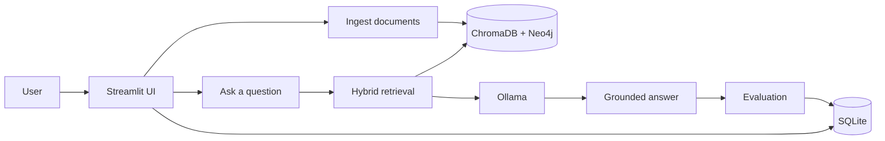
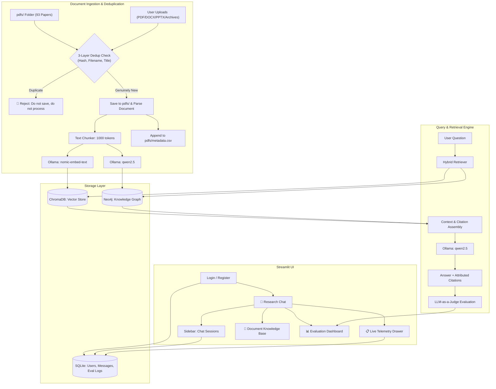
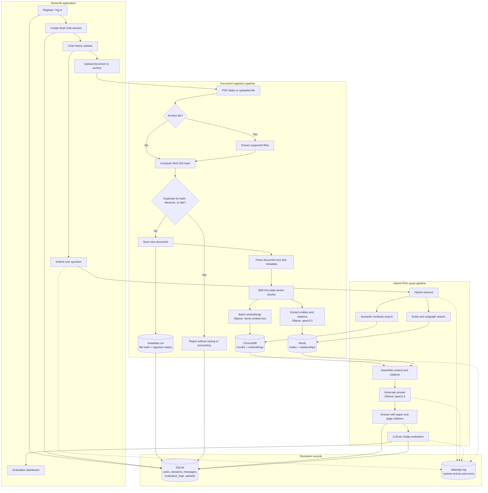

# 🧬 Graph RAG Chatbot Studio

> A scientific research assistant powered by **Hybrid Graph RAG** (Knowledge Graph + Vector Embeddings) and **Local Ollama Models**. Includes user authentication, persistent chat history, document uploads with strict deduplication, and a live RAG evaluation dashboard.

---

## 🌟 Key Features

- **Hybrid Retrieval (Graph + Vector)**: Traverses structured entity relationships in **Neo4j** while simultaneously performing dense semantic similarity search in **ChromaDB**.
- **100% Local & Privacy-Preserving**: Runs locally via **Ollama** (`qwen2.5` for generation/entity extraction, `nomic-embed-text` for embeddings). No API keys or external data transmission.
- **Dual Data Sources**:
  1. **Initial Repository**: 93 research papers pre-loaded in the `pdfs/` folder.
  2. **Dynamic UI Uploads**: Users can upload new papers directly in the Streamlit UI.
- **Strict Deduplication & Metadata Protection**:
  - `pdfs/metadata.csv` acts as the single source of truth and catalog.
  - Checks in-memory (SHA-256 hash, filename, and paper title) **before saving anything to disk**.
  - **If a file already exists in our data**: It is **NOT saved** to disk and **NO backend processing** (no chunking, embedding, or graph building) is performed.
- **Multi-Format & Archive Ingestion**: Supports `.pdf`, `.docx` (Word), `.pptx` (PowerPoint), `.txt`, `.md`, and automatic unpacking of `.zip`, `.rar`, `.7z`, and `.tar.gz`.
- **User Authentication**: Secure registration and login powered by `bcrypt` password hashing and `JWT` session tokens.
- **Persistent Chat History**: Multi-session conversation management stored in SQLite with expandable paper citations and page numbers.
- **Live RAG Evaluation**: Real-time scoring using **LLM-as-a-Judge** (Faithfulness, Answer Relevance, Context Relevance) plus millisecond latency telemetry across retrieval, generation, and evaluation stages.

---

## 🏗️ Architecture & Pipeline



The detailed implementation flow is :

<details>
<summary>Detailed architecture diagram</summary>



---

## 🔄 End-to-End Pipeline Visualization

The following flow shows how documents and user questions move through the
system, including persistence, evaluation, and runtime observability:



### Pipeline stages

1. **Authentication and sessions**: A successful login creates a new empty chat
   session. Existing sessions remain persisted and available in the sidebar.
2. **Ingestion**: Files are checked for duplicates before parsing or storage.
   New documents are parsed, chunked, embedded into ChromaDB, and represented
   as entities and relationships in Neo4j.
3. **Hybrid retrieval**: Each question searches both ChromaDB for relevant text
   and Neo4j for connected graph facts. The results are merged with citations.
4. **Answer generation**: Ollama generates an answer grounded in the assembled
   context and the relevant paper/page sources.
5. **Evaluation and observability**: Faithfulness, answer relevance, context
   relevance, and stage latency are stored in SQLite. Runtime events are also
   written to `data/app.log` and the Streamlit terminal.

</details>

## 📊 How It Works (In Simple Words)

1. **Initial Startup (Mode A)**:
   The system scans the `pdfs/` folder containing the research papers and checks `pdfs/metadata.csv`. Any papers not yet indexed are parsed, split into overlapping chunks, embedded using `nomic-embed-text` into ChromaDB, and their entities (authors, topics, methods, datasets) are inserted into Neo4j.

2. **When a User Uploads a File (Mode B)**:
   - When a user uploads a document or archive via the UI, the system calculates its SHA-256 fingerprint in memory.
   - It cross-references `metadata.csv` for content hash, filename, and paper title.
   - **If a duplicate is found**: The system **immediately rejects** the file. It is **never saved to disk**, and **no backend compute is spent**. The user receives an informative warning showing the matching document title.
   - **If the file is new**: It is saved to `pdfs/`, processed into ChromaDB and Neo4j, and registered into `metadata.csv`.

3. **When a User Asks a Question**:
   - The query searches ChromaDB for semantically similar paragraphs.
   - It simultaneously queries Neo4j for connected entities and relationships.
   - Both results are combined into a structured prompt with source citations.
   - `qwen2.5` answers the question with explicit references to paper titles and page numbers.
   - An automated judge evaluates the response's faithfulness, relevance, and latency live.

---

## 🚀 Step-by-Step Setup Guide

Follow these commands to configure and run the project from start to finish.

### 1. Prerequisites
- **Python**: Version `3.12`
- **UV Package Manager**: Installed on your system (`pip install uv` or `curl -LsSf https://astral.sh/uv/install.sh | sh`)
- **Ollama**: Installed and running locally ([Download Ollama](https://ollama.com/))
- **Neo4j** *(Recommended)*: Running via Docker or Neo4j Desktop.

### 2. Pull Required Ollama Models
Ensure Ollama is running, then pull the LLM and Embedding models:
```bash
ollama pull qwen2.5
ollama pull nomic-embed-text
```

### 3. Run Neo4j (Optional / Recommended)
If you have Docker installed, start Neo4j with one command:
```bash
docker run -d --name neo4j-graph \
  -p 7474:7474 -p 7687:7687 \
  -e NEO4J_AUTH=neo4j/password123 \
  neo4j:latest
```
*(Note: If Neo4j is offline, the system automatically falls back to dense vector search via ChromaDB).*

### 4. Install Project Dependencies
Using UV, install all dependencies locked in `pyproject.toml`:
```bash
uv sync
```

### 5. Configure Environment Variables
Copy `.env.example` to `.env` and verify settings:
```bash
cp .env.example .env
```
Key configuration items in `.env`:
```env
OLLAMA_BASE_URL=http://localhost:11434
OLLAMA_LLM_MODEL=qwen2.5
OLLAMA_EMBED_MODEL=nomic-embed-text

NEO4J_URI=neo4j+s://xxxxxxxx.databases.neo4j.io
NEO4J_USER=
NEO4J_PASSWORD=

PDF_DIR=pdfs
METADATA_FILE=pdfs/metadata.csv
DATA_DIR=data
LOG_LEVEL=INFO
APP_LOG_FILE=data/app.log
```

Runtime logs are written to `data/app.log` and also displayed in the terminal.
The file rotates at 5 MB and keeps up to three backup files.

### 6. Initialize SQLite Database
Initialize all database tables (users, chat sessions, messages, evaluation logs):
```bash
uv run python scripts/setup_db.py
```

### 7. Run Batch Ingestion (Initial Papers)
To index the papers located in `pdfs/`:
```bash
uv run python scripts/ingest.py
```
*Tip: If you rerun this command, it checks `metadata.csv` and skips papers already ingested.*

### 8. Launch the Streamlit Web Application
Start the interactive UI directly from the project root:
```bash
uv run streamlit run app.py
```
Open your browser at `http://localhost:8501`.

---

## 📁 Project Directory Tour

```
graph-rag/
├── app.py                        # Main Streamlit application entry point
├── .env                          # Local secrets & settings (gitignored)
├── .env.example                  # Template configuration for team members
├── pyproject.toml                # UV project configuration and dependencies
├── README.md                     # Documentation and architecture guide
├── pdfs/                         # Knowledge base documents
│   ├── metadata.csv              # Single source of truth catalog & registry
│   └── *.pdf                     # Research papers
│
├── scripts/
│   ├── setup_db.py               # Initializes SQLite tables
│   ├── ingest.py                 # CLI batch ingestion for pdfs/ folder
│   └── test_dedup.py             # Deduplication verification test
│
└── src/graph_rag/
    ├── config.py                 # Loads and validates .env settings
    │
    ├── database/
    │   └── db.py                 # SQLite connection & schema definitions
    │
    ├── auth/
    │   ├── models.py             # User dataclass
    │   ├── jwt_handler.py        # Token generation & verification
    │   └── auth_service.py       # bcrypt hashing & login/register logic
    │
    ├── chat/
    │   ├── models.py             # ChatSession & ChatMessage dataclasses
    │   └── chat_service.py       # Session CRUD & message history
    │
    ├── ingestion/
    │   ├── metadata_manager.py   # Thread-safe read/append for metadata.csv
    │   ├── dedup_checker.py      # 3-layer in-memory duplicate detector
    │   ├── pdf_parser.py         # PyMuPDF text & heading extraction
    │   ├── docx_parser.py        # Word text extractor
    │   ├── pptx_parser.py        # PowerPoint text extractor
    │   ├── archive_handler.py    # Safe ZIP/RAR/7z/tar unpacker
    │   ├── file_handler.py       # Format router
    │   ├── chunker.py            # 1000-token chunker with overlap (150 tokens)
    │   └── pipeline.py           # Ingestion orchestrator (batch & upload)
    │
    ├── embeddings/
    │   └── vector_store.py       # Persistent ChromaDB store + nomic-embed-text
    │
    ├── graph/
    │   ├── entity_extractor.py   # qwen2.5 entity/relationship extraction
    │   ├── graph_builder.py      # Neo4j driver & node/edge creator
    │   └── graph_queries.py      # Cypher multi-hop query helpers
    │
    ├── llm/
    │   └── ollama_client.py      # Ollama API client wrapper
    │
    ├── retriever/
    │   ├── hybrid_retriever.py   # Combines ChromaDB and Neo4j context
    │   └── query_engine.py       # Coordinates retrieval, generation & eval
    │
    ├── evaluation/
    │   ├── metrics.py            # LLM-as-a-Judge evaluators
    │   ├── latency_tracker.py    # Per-stage millisecond timers
    │   └── eval_service.py       # Logging & aggregate metrics
    │
    └── ui/
        ├── components.py         # Design tokens, custom CSS & sidebar
        ├── login_page.py         # Login & account creation portal
        ├── chat_page.py          # Interactive chat with citations & score badges
        ├── upload_page.py        # File & archive upload with dedup feedback
        └── eval_page.py          # Real-time RAG evaluation dashboard
```

---

## 🛡️ Deduplication Verification Rules

| Check Level | Verification Method | Action if Matched |
|---|---|---|
| **1. Content Hash** | SHA-256 computed on bytes in memory | **Reject**: File not written to disk; backend skipped |
| **2. Local Filename** | Exact filename matched against `metadata.csv` | **Reject**: File not written to disk; backend skipped |
| **3. Title Similarity** | Normalized fuzzy match against paper titles | **Reject**: File not written to disk; backend skipped |

When an upload is rejected, the UI displays a clear notice with the matching existing paper's title and hash. When accepted, the document is saved into `pdfs/`, vector and graph databases are updated, and its record is appended to `metadata.csv`.

---