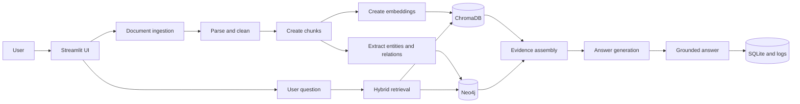
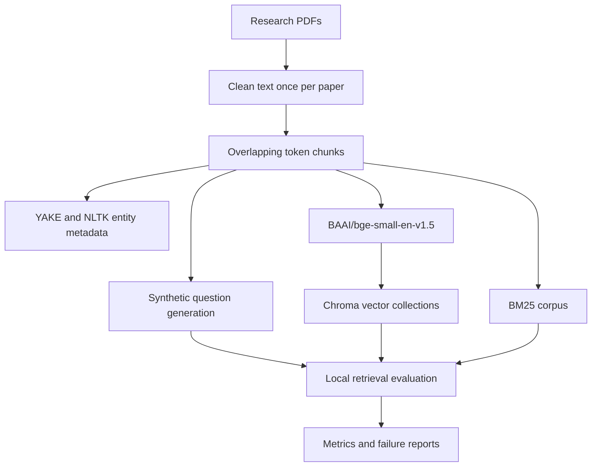

# Architecture and Workflow

## Application architecture

The application is a Streamlit hybrid Graph RAG system. Documents are parsed
and indexed into ChromaDB for vector retrieval and Neo4j for graph traversal.
Questions use both stores before answer generation.

## Application workflow

1. A user signs in and opens a chat session.
2. The ingestion path accepts repository documents or supported uploads.
3. Files are checked for duplicates before backend processing.
4. New documents are parsed, cleaned, chunked, embedded, and indexed.
5. Entities and relationships are extracted into the graph store.
6. A question is classified and sent through vector and graph retrieval.
7. Retrieved evidence is assembled with source metadata.
8. The local language model generates a grounded answer.
9. Session history, evaluation data, and runtime telemetry are persisted.

## Retrieval-lab pipeline

The lab is a separate, small-scale benchmark and does not require Neo4j:

## Retrieval-lab workflow

1. Select the nine-paper corpus.
2. Extract and save cleaned text with checksums.
3. Generate 256/26 and 384/38 overlapping chunks.
4. Verify every chunk against its cleaned-text character span.
5. Store entities as metadata only; do not use them for retrieval.
6. Embed both chunk sets with the local BGE model.
7. Run the six vector-store sanity checks for each collection.
8. Validate synthetic questions and their gold chunk spans.
9. Compare vector retrieval with BM25 using the same questions.
10. Save metrics, per-question results, failures, and cost calculations.

## Data boundaries

- Neo4j is used by the application graph workflow, not by the retrieval-lab
  benchmark.
- Lab runtime data belongs under ignored `data\lab\` and must not be committed.
- `.env`, API keys, PDFs, and generated databases remain outside version
  control.

