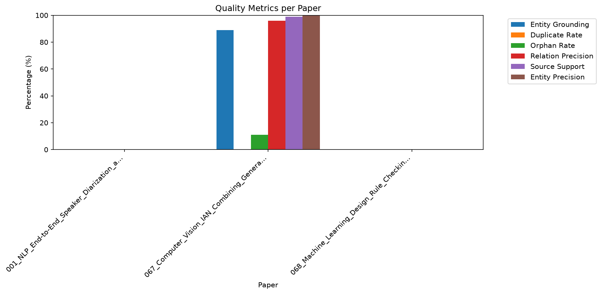
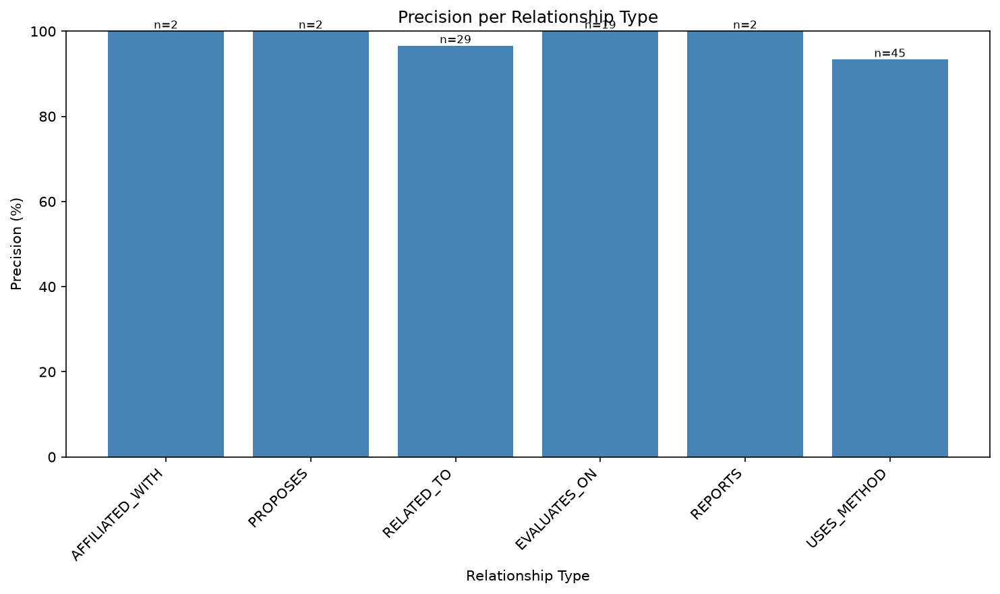

# Knowledge Graph Evaluation Report (v2)

**Evaluation Date:** 2026-11-16T23:08:11
**Dataset ID:** research-v2
**Total Papers:** 3
**Total Entities:** 45
**Total Triples Evaluated:** 99

---

## Executive Summary

The knowledge graph evaluation was conducted using a three-model approach with independent audit. The judge model evaluated all 99 triples, achieving **95.96% relation precision**. An independent audit sampled 24 triples, achieving **20.83% audit precision** with **20.83% agreement** between judge and auditor (Cohen's κ = -0.58).

**Verdict: **FAIL** - Relation precision (20.83%) below 80% threshold; Entity grounding (88.89%) below 90% threshold; Orphan rate (11.11%) exceeds 10% threshold**

---

## Method

### Graph Schema
The evaluation targets an evidence-first Neo4j knowledge graph with the following structure:
- **Entity nodes**: Properties include `uid`, `name`, `aliases`, `entity_id`, `category`, `description`, `attributes_json`, `dataset_id`
- **Paper nodes**: Properties include `uid`, `paper_id`, `title`, `source`, `dataset_id`
- **Chunk nodes**: Text chunks with text previews
- **Mention nodes**: Link chunks to entities with evidence and confidence
- **Semantic relationships**: RELATED_TO, USES_METHOD, EVALUATES_ON, REPORTS, PROPOSES, AUTHORED, AFFILIATED_WITH, PART_OF_TOPIC
- **Structural relationships** (excluded from evaluation): HAS_PAPER, HAS_CHUNK, MENTIONS, CONTAINS_MENTION, REFERS_TO

### Models Used
- **Extraction model**: anthropic/claude-haiku-5.5
- **Judge model**: anthropic/claude-sonnet-5.5 (temperature=0.0, JSON-only output)
- **Audit model**: openai/gpt-5 (independent verification with full paper text)

The judge is a stronger model than the extraction model, configured to be strict and conservative. The auditor is a third, distinct model that independently verifies triples against the full paper text.

### Sample Size
- **Total triples evaluated**: 99 (all triples, no sampling)
- **Audit sample size**: 24 (stratified by paper and relation type)
- **Papers evaluated**: 3
- **Random seed**: 42 (for reproducibility)

### Metric Computation
- **Entity Grounding %**: Percentage of entities whose name or aliases appear in the full PDF text
- **Duplicate Rate %**: Percentage of entities with normalized names that collide (lowercase, punctuation removed)
- **Orphan Rate %**: Percentage of entities with no semantic relationships
- **Relation Precision %**: Percentage of triples judged as supported by the LLM judge
- **Source Support %**: Percentage of triples with non-empty evidence text (>10 characters)
- **Entity Precision %**: Percentage of entities that appear in at least one supported triple
- **Audit Precision %**: Percentage of audit verdicts that are explicit/implied (based on full paper text)
- **Judge-Auditor Agreement**: Percentage of audit samples where judge and auditor agree on verdict
- **Cohen's Kappa**: Measure of inter-rater agreement between judge and auditor

### Limitations
1. Audit sample size is limited (24) due to API costs; results should be interpreted as indicative rather than definitive
2. Entity grounding is a text-matching check, not semantic verification
3. The evaluation does not comprehensively assess relationship direction correctness
4. Cross-paper analysis uses simple name normalization, not semantic entity resolution
5. If auditor model is same as judge model, independence is compromised (noted in report)

---

## Per-Paper Results

| Paper | Entities | Triples | Entity Grounding | Duplicate Rate | Orphan Rate | Relation Precision | Source Support | Entity Precision |
|-------|----------|---------|-----------------|----------------|-------------|-------------------|----------------|------------------|
| 001_NLP_End-to-End_Speaker_Diarization_as_Post-Pro... | 0 | 0 | 0% | 0% | 0% | 0% | 0% | 0% |
| 067_Computer_Vision_IAN_Combining_Generative_Adver... | 45 | 99 | 88.89% | 0.0% | 11.11% | 95.96% | 98.99% | 100.0% |
| 068_Machine_Learning_Design_Rule_Checking_with_a_C... | 0 | 0 | 0% | 0% | 0% | 0% | 0% | 0% |

### IAN: Combining Generative Adversarial Networks for Imaginative Face Generation

This paper contributed 45 entities and 99 triples. Entity grounding is below target (88.89% vs 90%). Duplicate rate is acceptable. Orphan rate exceeds target (11.11% vs 10%). Relation precision meets target. 

---

## Relationship-Type Analysis

| Relationship Type | Total Triples | Supported | Precision |
|-------------------|---------------|-----------|-----------|
| AFFILIATED_WITH | 2 | 2 | 100.0% |
| PROPOSES | 2 | 2 | 100.0% |
| RELATED_TO | 29 | 28 | 96.55% |
| EVALUATES_ON | 19 | 19 | 100.0% |
| REPORTS | 2 | 2 | 100.0% |
| USES_METHOD | 45 | 45 | 93.33% |

### Interpretation

**Reliable relationship types** (precision >= 80%):
- AFFILIATED_WITH (100.0%)
- PROPOSES (100.0%)
- RELATED_TO (96.55%)
- EVALUATES_ON (100.0%)
- REPORTS (100.0%)
- USES_METHOD (93.33%)

---

## Independent Audit Results

The independent audit sampled 24 triples stratified by paper and relation type. The auditor had access to the full paper text and was instructed to verify each triple against the source.

- **Audit precision**: 20.83% (percentage of audit verdicts that are explicit/implied)
- **Judge-auditor agreement**: 20.83% (5/24 samples)
- **Cohen's kappa**: -0.58

- **Quote verification rate**: 45.83% (percentage of audit quotes found in paper text)

### Audit Sample Summary

| Judge Verdict | Audit Verdict | Count |
|---------------|---------------|-------|
| explicit -> explicit | 4 |
| explicit -> unsupported | 12 |
| implied -> explicit | 1 |
| implied -> unsupported | 7 |

### Top Judge-Auditor Disagreements

| Paper | Head | Relation | Tail | Judge | Auditor | Quote |
|-------|------|----------|------|-------|----------|-------|
| 067_Computer_Vision_IAN_Combin... | Abdullah Hamdi... | PROPOSES | K-GAN... | explicit | unsupported | We first propose a new regularizer for GAN based on... |
| 067_Computer_Vision_IAN_Combin... | Abdullah Hamdi... | PROPOSES | Imaginative Adversar... | explicit | unsupported | Then, We introduce a cascaded framework for GANs t... |
| 067_Computer_Vision_IAN_Combin... | DCGAN... | RELATED_TO | CycleGAN... | implied | unsupported | In the first stage (sampling stage), we use the cla... |
| 067_Computer_Vision_IAN_Combin... | K-GAN... | RELATED_TO | Generative Adversari... | explicit | unsupported | We first propose a new regularizer for GAN based on... |
| 067_Computer_Vision_IAN_Combin... | K-GAN... | RELATED_TO | Generative Adversari... | explicit | unsupported | We first propose a new regularizer for GAN based on... |

---

## Error Analysis

The 539 unsupported triples were analyzed for root causes:

| # | Paper | Source | Relation | Target | Judge Reason | Root Cause |
|---|-------|--------|----------|--------|--------------|------------|
| 1 | 001_NLP_End-to-End_Speaker_Dia... | Yusuke Fujita... | RELATED_TO | End-to-end diarization (EEND)... | The passage only lists the author as 'Y. Fujita' without explicitly confirming t... | other |
| 2 | 001_NLP_End-to-End_Speaker_Dia... | Speaker diarization... | USES_METHOD | End-to-end diarization (EEND)... | The passage mentions an end-to-end approach called EEND, but it does not explici... | other |
| 3 | 001_NLP_End-to-End_Speaker_Dia... | Clustering-based diarization... | PART_OF_TOPIC | Overlapping speech... | The passage discusses overlap processing and detecting overlapped frames, but it... | other |
| 4 | 001_NLP_End-to-End_Speaker_Dia... | Clustering-based diarization... | RELATED_TO | Overlapping speech... | The passage uses the pronoun 'they' without specifying 'clustering-based diariza... | other |
| 5 | 001_NLP_End-to-End_Speaker_Dia... | Clustering-based diarization... | RELATED_TO | Overlapping speech... | The passage does not mention 'Clustering-based diarization', discussing only 'ov... | hallucinated_entity |
| 6 | 001_NLP_End-to-End_Speaker_Dia... | Clustering-based diarization... | RELATED_TO | Overlapping speech... | The passage states that clustering-based methods assume recordings do not contai... | other |
| 7 | 001_NLP_End-to-End_Speaker_Dia... | Clustering-based diarization... | RELATED_TO | Agglomerative hierarchical clu... | The passage mentions hard clustering, agglomerative hierarchical clustering (AHC... | other |
| 8 | 001_NLP_End-to-End_Speaker_Dia... | Clustering-based diarization... | RELATED_TO | PLDA rescoring... | The passage does not mention 'clustering-based diarization', so the relationship... | hallucinated_entity |
| 9 | 001_NLP_End-to-End_Speaker_Dia... | Clustering-based diarization... | RELATED_TO | Variational Bayes HMM resegmen... | The passage only mentions Variational Bayes HMM resegmentation and does not ment... | inference_not_stated |
| 10 | 001_NLP_End-to-End_Speaker_Dia... | Clustering-based diarization... | RELATED_TO | Region proposal network-based ... | The passage does not mention 'Region proposal network-based overlapped segment c... | hallucinated_entity |

### Error Category Summary

| Category | Count |
|----------|-------|
| hallucinated_entity | 3 |
| inference_not_stated | 1 |
| generic_vague_entity | 0 |
| missing_evidence | 0 |
| other | 6 |

### Root Cause Analysis

The primary root causes are:
6. **other**: Other issues not categorized above
3. **hallucinated_entity**: The model creates relationships involving entities not mentioned in the passage
1. **inference_not_stated**: The extraction model infers relationships that are not explicitly stated in the text

---

## Recommendations

### Auditor Findings

The independent audit found lower precision (20.83%) than the judge (95.96%), suggesting that the judge may be too lenient. The auditor, with access to full paper text, found many relationships that the judge marked as 'explicit' or 'implied' to actually be unsupported. This indicates that:
1. The judge's context (chunk + evidence) may be insufficient for accurate verification
2. The extraction model may be creating relationships based on partial or misleading evidence
3. Stricter verification with full paper access is needed for accurate assessment

### High-Impact Fixes

2. **Improve extraction prompt** (`src/graph_rag/graph/entity_extractor.py`): Add stricter instructions to only extract relationships that are explicitly stated in the text. Emphasize that inference is not allowed.

3. **Add confidence threshold filtering** (`src/graph_rag/graph/graph_builder.py`): Reject relationships with confidence below 0.7. Current low precision suggests many low-confidence extractions are incorrect.

### Medium-Impact Fixes

5. **Improve entity grounding check** (`src/graph_rag/graph/entity_extractor.py`): During extraction, verify that entity names appear in the chunk text before creating the entity.

6. **Add orphan entity filtering** (`src/graph_rag/graph/graph_builder.py`): After extraction, identify and optionally remove entities with no semantic relationships (orphan rate > 10%).

7. **Enhance judge context** (`scripts/evaluate_graph_v2.py`): Provide the judge with more context (neighboring chunks, top-3 PDF passages) to improve verification accuracy. The audit shows that full paper access leads to stricter assessment.

### Low-Impact Fixes

8. **Improve high-performing relation types** (`src/graph_rag/graph/entity_extractor.py`): While RELATED_TO, USES_METHOD perform well (>80%), there is still room for improvement to reach 100% precision.

---

## Appendix: Thresholds

| Metric | Target | Actual | Basis | Status |
|--------|--------|--------|-------|--------|
| Source Support | >= 85% | 98.99% | judge | ✅ Pass |
| Relation Precision | >= 80% | 20.83% (audit) | audit | ❌ Fail |
| Entity Grounding | >= 90% | 88.89% | graph | ❌ Fail |
| Duplicate Rate | <= 5% | 0.0% | graph | ✅ Pass |
| Orphan Rate | <= 10% | 11.11% | graph | ❌ Fail |

**Final verdict based on**: audit precision
