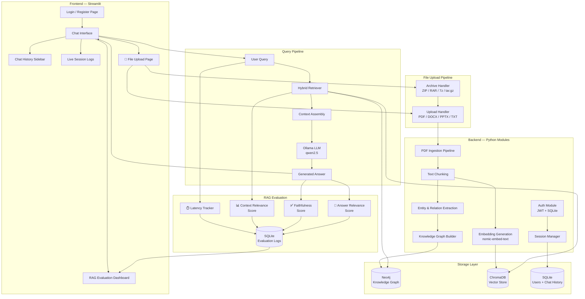

# 📋 Graph RAG Chatbot — Project Plan

## Overview

Build a **PDF-powered Q&A chatbot** that uses **Graph RAG** (Retrieval-Augmented Generation with a knowledge graph) and **local Ollama models** to answer questions about research papers. The system includes **user authentication**, **chat history**, **live session logs**, and **real-time RAG evaluation**, all served through a clean **Streamlit UI**.

---

## 🏗️ Architecture



---

## 📁 Project Structure

```
graph-rag/
├── .env                          # All secrets & config (gitignored)
├── .env.example                  # Template for team members
├── pyproject.toml                # UV project config + dependencies
├── README.md                     # Full documentation + setup guide
├── pdfs/                         # ALL documents + metadata.csv (single source of truth)
│   └── metadata.csv              # Document registry: tracks every file in the system
│
├── src/graph_rag/
│   ├── __init__.py               # Package entry point
│   │
│   ├── config.py                 # Load .env, define all settings
│   │
│   ├── ingestion/                # Document processing pipeline
│   │   ├── __init__.py
│   │   ├── pdf_parser.py         # Extract text from PDFs
│   │   ├── docx_parser.py        # Extract text from Word (.docx)
│   │   ├── pptx_parser.py        # Extract text from PowerPoint (.pptx)
│   │   ├── file_handler.py       # Detect file type → route to correct parser
│   │   ├── archive_handler.py    # Extract ZIP/RAR/7z/tar.gz → return file list
│   │   ├── dedup_checker.py      # Check duplicates against metadata.csv (hash + title + filename)
│   │   ├── metadata_manager.py   # Read, query, and append to metadata.csv
│   │   ├── chunker.py            # Split text into chunks
│   │   └── pipeline.py           # Orchestrate full ingestion (batch + single)
│   │
│   ├── graph/                    # Knowledge graph construction
│   │   ├── __init__.py
│   │   ├── entity_extractor.py   # Extract entities via Ollama LLM
│   │   ├── graph_builder.py      # Build graph in Neo4j
│   │   └── graph_queries.py      # Cypher query helpers
│   │
│   ├── embeddings/               # Vector embedding layer
│   │   ├── __init__.py
│   │   └── vector_store.py       # ChromaDB + nomic-embed-text
│   │
│   ├── retriever/                # Hybrid retrieval (Graph + Vector)
│   │   ├── __init__.py
│   │   └── hybrid_retriever.py   # Combine graph + vector results
│   │
│   ├── llm/                      # LLM answer generation
│   │   ├── __init__.py
│   │   └── ollama_client.py      # Ollama API wrapper for qwen2.5
│   │
│   ├── auth/                     # Authentication system
│   │   ├── __init__.py
│   │   ├── models.py             # User model (SQLite)
│   │   ├── jwt_handler.py        # JWT create/verify tokens
│   │   └── auth_service.py       # Register, login, validate
│   │
│   ├── chat/                     # Chat history management
│   │   ├── __init__.py
│   │   ├── models.py             # Chat session & message models
│   │   └── chat_service.py       # CRUD for chat history
│   │
│   ├── evaluation/               # RAG quality evaluation
│   │   ├── __init__.py
│   │   ├── metrics.py            # Faithfulness, relevance, context scorers
│   │   ├── latency_tracker.py    # Per-stage timing instrumentation
│   │   └── eval_service.py       # Log & query evaluation results
│   │
│   ├── database/                 # Database setup
│   │   ├── __init__.py
│   │   └── db.py                 # SQLite connection & schema init
│   │
│   └── ui/                       # Streamlit pages
│       ├── app.py                # Main Streamlit entry point
│       ├── login_page.py         # Login & registration UI
│       ├── chat_page.py          # Chat interface
│       ├── upload_page.py        # File upload & ingestion UI
│       ├── eval_page.py          # RAG evaluation dashboard
│       └── components.py         # Shared UI components
│
└── scripts/
    ├── ingest.py                 # CLI: run PDF ingestion pipeline
    └── setup_db.py               # CLI: initialize SQLite database
```

---

## 🔧 Technology Stack

| Component | Technology | Purpose |
|---|---|---|
| **LLM** | Ollama — `qwen2.5` | Generate answers & extract entities |
| **Embeddings** | Ollama — `nomic-embed-text` | Create vector embeddings for chunks |
| **Knowledge Graph** | Neo4j | Store entities & relationships |
| **Vector Store** | ChromaDB | Store & search text embeddings |
| **User DB** | SQLite | Users, chat history, sessions, eval logs |
| **Auth** | JWT (PyJWT) | Secure authentication tokens |
| **RAG Evaluation** | LLM-as-Judge + Timers | Score retrieval & answer quality live |
| **UI** | Streamlit | Web-based chat + eval + file upload |
| **PDF Parsing** | PyMuPDF (fitz) | Extract text from PDFs |
| **DOCX Parsing** | python-docx | Extract text from Word documents |
| **PPTX Parsing** | python-pptx | Extract text from PowerPoint files |
| **Archive Handling** | zipfile, rarfile, py7zr, tarfile | Extract compressed file archives |
| **Project Mgmt** | UV | Python package & dependency management |

---

## 🔑 Environment Variables (.env)

```env
# ── Ollama Configuration ──
OLLAMA_BASE_URL=http://localhost:11434
OLLAMA_LLM_MODEL=qwen2.5
OLLAMA_EMBED_MODEL=nomic-embed-text

# ── Neo4j Configuration ──
NEO4J_URI=bolt://localhost:7687
NEO4J_USER=neo4j
NEO4J_PASSWORD=your_neo4j_password

# ── Data Paths ──
PDF_DIR=pdfs
UPLOAD_DIR=data/uploads
CHROMA_PERSIST_DIR=data/chroma_db
SQLITE_DB_PATH=data/graph_rag.db
MAX_UPLOAD_SIZE_MB=200

# ── JWT Configuration ──
JWT_SECRET_KEY=your-super-secret-key-change-this
JWT_ALGORITHM=HS256
JWT_EXPIRY_HOURS=24

# ── Ingestion Settings ──
CHUNK_SIZE=512
CHUNK_OVERLAP=50

# ── RAG Evaluation ──
RAG_EVAL_ENABLED=true

# ── App Settings ──
APP_HOST=localhost
APP_PORT=8501
LOG_LEVEL=INFO
```

---

## 📦 Dependencies

```
# Core
streamlit
python-dotenv
pyjwt
bcrypt

# Document Processing
pymupdf              # PDF text extraction
python-docx          # Word (.docx) text extraction
python-pptx          # PowerPoint (.pptx) text extraction

# Archive Handling
rarfile              # RAR archive extraction
py7zr                # 7z archive extraction
# (zipfile and tarfile are Python built-ins)

# Graph Database
neo4j

# Vector Store & Embeddings
chromadb
httpx

# LLM
ollama

# Utilities
pandas
```

---

## 🚀 Implementation Phases

### Phase 1: Foundation & Configuration
> Set up project skeleton, config system, and database

1. Update `pyproject.toml` with all dependencies
2. Create `config.py` to load all `.env` variables
3. Create `database/db.py` with SQLite schema (users, chat_sessions, messages)
4. Create `scripts/setup_db.py`
5. Update `.env` and `.env.example`

### Phase 2: Document Ingestion Pipeline
> Parse documents, check duplicates, chunk text, manage metadata registry

**Core principle**: `metadata.csv` is the **single source of truth** and document registry.
- **Initial data source**: The 93 research papers in `pdfs/` folder. The system indexes this folder at setup.
- **Dynamic data source**: User-uploaded documents (single/multi-file or archives) uploaded via the Streamlit UI.
- **Strict Deduplication Rule**:
  - The duplicate check is performed **in memory** *before* any file is written to disk.
  - If a file already exists in our data (matched by SHA-256 hash, filename, or paper title):
    - 🚫 **DO NOT SAVE** the file to disk (no file written to `pdfs/` or permanent storage).
    - 🚫 **DO NOT APPLY BACKEND PROCESSING** (no chunking, no embedding generation, no graph insertion).
    - ⚠️ **NOTIFY USER** in the UI with the exact matched document title and reason.
  - If and only if the file is genuinely new:
    - Save file to `pdfs/`.
    - Run backend ingestion (text extraction, chunking, Ollama embeddings into ChromaDB, entity extraction into Neo4j).
    - Append new metadata row to `metadata.csv`.
    - Record status in SQLite `uploaded_documents` table.

**metadata.csv columns** (existing format preserved + tracking columns):
```
topic, title, authors, published, arxiv_id, abstract, abstract_url, pdf_url, categories, local_pdf, source, file_hash, ingested_at
```
- `source`: `"initial"` for pre-loaded papers in `pdfs/`, `"upload"` for user-uploaded files
- `file_hash`: SHA-256 hash of file content (used for fast, collision-free duplicate checking)
- `ingested_at`: ISO timestamp when the file was ingested into ChromaDB and Neo4j

**Implementation:**

1. `pdf_parser.py` — extract text and document title/metadata from PDFs using PyMuPDF (`fitz`).
2. `docx_parser.py` — extract text from Word documents using `python-docx`.
3. `pptx_parser.py` — extract text from PowerPoint using `python-pptx`.
4. `file_handler.py` — detect file type by extension/MIME → route to the correct parser:

   | Format | Extensions | Parser |
   |---|---|---|
   | PDF | `.pdf` | PyMuPDF |
   | Word | `.docx` | python-docx |
   | PowerPoint | `.pptx` | python-pptx |
   | Plain Text | `.txt`, `.md` | built-in open() |

5. `archive_handler.py` — detect and unpack compressed archives into memory or temp sandbox:

   | Archive Type | Extensions | Library |
   |---|---|---|
   | ZIP | `.zip` | `zipfile` (built-in) |
   | RAR | `.rar` | `rarfile` |
   | 7-Zip | `.7z` | `py7zr` |
   | TAR/GZ | `.tar`, `.tar.gz`, `.tgz` | `tarfile` (built-in) |

   Flow: Archive uploaded → inspect files → filter supported documents → stream each file to `dedup_checker` → clean up temp sandbox.

6. `dedup_checker.py` — **3-layer duplicate detection** against `metadata.csv`:

   | Check Level | Verification Method | Why / When It Triggers | Action if Matched |
   |---|---|---|---|
   | **1. File Hash** | SHA-256 hash of file bytes compared against `file_hash` column | Catches exact file duplicates even if renamed | **Reject**: do not save, do not process |
   | **2. Local Filename** | Exact filename compared against `local_pdf` column | Catches re-uploads of existing papers | **Reject**: do not save, do not process |
   | **3. Title Similarity** | Normalized fuzzy match of extracted title against `title` column | Catches re-downloads or modified copies of existing papers | **Reject**: do not save, do not process |

   Returns:
   ```python
   {
       "is_duplicate": True | False,
       "match_type": "hash" | "filename" | "title" | None,
       "matched_doc": {"title": "...", "local_pdf": "...", "file_hash": "..."},
       "message": "File already exists in knowledge base: ..."
   }
   ```

7. `metadata_manager.py` — read, query, and **append** to `metadata.csv`:
   - `load_metadata()` → read `pdfs/metadata.csv` into Pandas DataFrame
   - `get_known_hashes()` → return set of known SHA-256 hashes for O(1) lookup
   - `get_known_filenames()` → return set of known filenames
   - `get_known_titles()` → return dictionary of titles for fuzzy matching
   - `is_ingested(local_pdf)` → check if paper was already processed into databases
   - `append_document(doc_info)` → safely append new record to `metadata.csv`
   - `mark_as_ingested(local_pdf, file_hash, timestamp)` → update status in registry

8. `chunker.py` — split text into 512-token chunks with 50-token overlap, retaining document title and source reference.
9. `pipeline.py` — orchestrate full ingestion with **two modes**:

   **Mode A — Initial batch ingestion (CLI / Startup Check):**
   ```
   1. Read pdfs/metadata.csv
   2. For each PDF in pdfs/ folder:
      a. Check if already ingested (ingested_at is not empty & exists in ChromaDB/Neo4j)
      b. If already ingested → SKIP (idempotent, no re-processing)
      c. If new/pending:
         - Compute SHA-256 hash
         - Extract text via pdf_parser
         - Chunk text via chunker
         - Generate embeddings with Ollama (nomic-embed-text) → store in ChromaDB
         - Extract entities/relationships with Ollama (qwen2.5) → store in Neo4j
         - Update metadata.csv with file_hash and ingested_at timestamp
   ```

   **Mode B — User upload ingestion (Streamlit UI, On-Demand):**
   ```
   1. User uploads file(s) or archive (ZIP/RAR/7z/tar.gz)
   2. Unpack archive if needed into memory/temp sandbox
   3. For EACH file:
      a. Compute SHA-256 hash in memory
      b. Query dedup_checker against metadata.csv (hash + filename + title)
      c. IF DUPLICATE:
         ❌ Do NOT save file to disk / pdfs/ folder
         ❌ Do NOT run any backend ingestion (skip chunking, embeddings, graph)
         ⚠️ UI alert: "File '[filename]' already exists in system as '[title]'. Skipped."
      d. IF NEW:
         ✅ Save file into pdfs/ folder
         ✅ Run parser → chunker → nomic-embed-text embeddings into ChromaDB
         ✅ Run qwen2.5 entity extraction into Neo4j
         ✅ Append new record to pdfs/metadata.csv
         ✅ Record success in SQLite uploaded_documents table
         🎉 UI alert: "Successfully added '[title]' to knowledge base!"
   ```

10. `scripts/ingest.py` — CLI script to run initial batch ingestion on `pdfs/`.

### Phase 3: Embeddings & Vector Store
> Generate embeddings and store in ChromaDB

1. `vector_store.py` — call Ollama `nomic-embed-text` for each chunk
2. Store chunks + embeddings + metadata in ChromaDB
3. Implement similarity search function

### Phase 4: Knowledge Graph Construction
> Extract entities/relationships, build Neo4j graph

1. `entity_extractor.py` — use `qwen2.5` to extract entities (authors, topics, methods, datasets) and relationships from chunks
2. `graph_builder.py` — create nodes and edges in Neo4j
3. `graph_queries.py` — Cypher query helpers for retrieval

### Phase 5: Hybrid Retriever & LLM
> Combine graph + vector retrieval, generate answers

1. `hybrid_retriever.py` — query both Neo4j (graph context) and ChromaDB (semantic similarity), merge and rank results
2. `ollama_client.py` — send assembled context + question to `qwen2.5`, return answer
3. Build the RAG prompt template

### Phase 6: Authentication System
> User registration, login, JWT tokens

1. `models.py` — User schema (id, username, email, password_hash, created_at)
2. `jwt_handler.py` — create and verify JWT tokens
3. `auth_service.py` — register, login, validate session

### Phase 7: Chat History
> Persistent chat sessions with message storage

1. `chat/models.py` — ChatSession and Message schemas
2. `chat_service.py` — create session, add message, list sessions, get messages
3. Wire into the query pipeline

### Phase 7.5: RAG Evaluation System
> Measure and log retrieval & answer quality in real-time

Every query is automatically scored on 4 dimensions using **LLM-as-Judge** (the same `qwen2.5` model evaluates its own outputs) plus latency tracking:

| Metric | What It Measures | How It Works |
|---|---|---|
| **Faithfulness** | Does the answer stick to the retrieved context? (no hallucination) | LLM checks if every claim in the answer is supported by the context chunks |
| **Answer Relevance** | Does the answer actually address the user's question? | LLM scores how well the answer matches the question intent |
| **Context Relevance** | Are the retrieved chunks relevant to the question? | LLM scores each retrieved chunk's relevance to the query |
| **Latency** | How fast is each pipeline stage? | Timers on: retrieval, context assembly, LLM generation, total |

Implementation:
1. `metrics.py` — Prompt templates for LLM-as-judge scoring (faithfulness, answer relevance, context relevance). Each returns a 0–1 score + reasoning.
2. `latency_tracker.py` — Context manager / decorator that times each stage (retrieval_ms, generation_ms, eval_ms, total_ms).
3. `eval_service.py` — Logs every evaluation to SQLite `evaluation_logs` table. Provides query functions for dashboards (avg scores, trends, per-session breakdown).
4. `ui/eval_page.py` — Streamlit dashboard showing:
   - Per-message scores (faithfulness, relevance, context relevance)
   - Session-level averages and trends
   - Latency breakdown charts (retrieval vs. generation vs. evaluation)
   - Filter by date, user, session

SQLite schema for evaluation:
```sql
CREATE TABLE evaluation_logs (
    id              INTEGER PRIMARY KEY AUTOINCREMENT,
    message_id      INTEGER REFERENCES messages(id),
    session_id      INTEGER REFERENCES chat_sessions(id),
    user_id         INTEGER REFERENCES users(id),
    question        TEXT,
    answer          TEXT,
    context_chunks  TEXT,       -- JSON array of retrieved chunks
    faithfulness    REAL,       -- 0.0 to 1.0
    answer_relevance REAL,      -- 0.0 to 1.0
    context_relevance REAL,     -- 0.0 to 1.0
    retrieval_ms    INTEGER,    -- milliseconds
    generation_ms   INTEGER,
    eval_ms         INTEGER,
    total_ms        INTEGER,
    eval_reasoning  TEXT,       -- JSON: judge explanations
    created_at      TIMESTAMP DEFAULT CURRENT_TIMESTAMP
);
```

### Phase 8: Streamlit UI
> Build the user-facing interface

1. `app.py` — main entry, routing, session state
2. `login_page.py` — login/register forms
3. `chat_page.py` — chat interface with:
   - Message display (user/assistant bubbles)
   - Inline evaluation badges (faithfulness/relevance scores per answer)
   - Chat history sidebar (previous sessions)
   - Live session log panel
   - New chat / clear history buttons
4. `upload_page.py` — file upload & ingestion UI:
   - Drag-and-drop file uploader (Streamlit `file_uploader` with `accept_multiple_files=True`)
   - Supported formats displayed clearly: PDF, DOCX, PPTX, TXT, ZIP, RAR, 7z, TAR.GZ
   - **Duplicate detection feedback**: if a file already exists, show clear warning with the matched document's title
   - Upload progress bar with per-file status (checking → parsing → chunking → embedding → done)
   - List of all documents in the system (from metadata.csv) with source tag (`initial` / `upload`)
   - File size validation (max from `.env`)
   - Archive contents preview before ingestion
5. `eval_page.py` — RAG evaluation dashboard with score charts, latency breakdown, and session filtering
6. `components.py` — shared widgets (header, sidebar, score badges, etc.)

SQLite schema for tracking uploaded documents:
```sql
CREATE TABLE uploaded_documents (
    id              INTEGER PRIMARY KEY AUTOINCREMENT,
    user_id         INTEGER REFERENCES users(id),
    filename        TEXT NOT NULL,
    file_type       TEXT NOT NULL,           -- 'pdf', 'docx', 'pptx', 'txt', 'archive'
    file_size_bytes INTEGER,
    source_archive  TEXT,                    -- original archive name if extracted
    num_chunks      INTEGER,                 -- how many chunks were created
    status          TEXT DEFAULT 'pending',  -- 'pending', 'processing', 'completed', 'failed'
    error_message   TEXT,
    created_at      TIMESTAMP DEFAULT CURRENT_TIMESTAMP
);
```

### Phase 9: Documentation & README
> Complete project documentation

1. Full README with:
   - Project description & architecture diagram
   - Prerequisites (Ollama, Neo4j, Python 3.12, UV)
   - Step-by-step setup commands
   - Pipeline explanation in simple words
   - Screenshots / usage guide
2. Inline code documentation (docstrings, comments)

---

## 📊 Data Flow (Simple Words)

```
┌─────────────────────────────────────────────────────────────┐
│              BATCH INGESTION (CLI — Run Once)                │
│                                                             │
│  PDF Files ──→ Extract Text ──→ Split into Chunks           │
│       │                              │                      │
│       │                              ├──→ Generate Embeddings│
│       │                              │    (nomic-embed-text) │
│       │                              │    Store in ChromaDB  │
│       │                              │                      │
│       │                              └──→ Extract Entities   │
│       │                                   (qwen2.5)         │
│  metadata.csv ──→ Paper info ──→          Build Neo4j Graph  │
└─────────────────────────────────────────────────────────────┘

┌─────────────────────────────────────────────────────────────┐
│             UI UPLOAD (On-Demand — Any Time)                 │
│                                                             │
│  User uploads file(s) via Streamlit UI                      │
│       │                                                     │
│       ├── Archive? (ZIP/RAR/7z/tar.gz)                      │
│       │       └──→ Unpack to temp sandbox → get file list   │
│       │                                                     │
│       ▼                                                     │
│  For EACH file:                                             │
│       │                                                     │
│       ├──→ ① Compute SHA-256 hash in memory                │
│       ├──→ ② Check metadata.csv (hash / title / filename)  │
│       │                                                     │
│       ├── DUPLICATE DETECTED?                               │
│       │   ├── ❌ DO NOT SAVE TO DISK                        │
│       │   ├── ❌ DO NOT APPLY BACKEND (No chunk/embed/graph)│
│       │   └── ⚠️ UI Warning: "Already in knowledge base"    │
│       │                                                     │
│       └── GENUINELY NEW FILE?                               │
│           ├── ✅ Save file to pdfs/ folder                  │
│           ├── ✅ Run Ingestion (Parse → Chunk → Embed)       │
│           ├── ✅ Extract Entities → Build Graph (Neo4j)     │
│           ├── ✅ Append new record to metadata.csv          │
│           └── ✅ Log in uploaded_documents (SQLite)         │
│                                                             │
│  🎉 User can immediately query knowledge from the new file!  │
└─────────────────────────────────────────────────────────────┘

┌─────────────────────────────────────────────────────────────┐
│                    QUERY (Every Question)                    │
│                                                             │
│  User Question                                              │
│       │                                                     │
│       ├──→ Search ChromaDB (similar chunks)    ⏱️ timed     │
│       │                                                     │
│       ├──→ Search Neo4j (related entities)     ⏱️ timed     │
│       │                                                     │
│       └──→ Combine Context ──→ Send to qwen2.5 ⏱️ timed    │
│                 │                      │                    │
│                 ▼                      ▼                    │
│           Context Relevance     Answer + Sources            │
│           Score (0-1)                  │                    │
│                                        ├──→ Faithfulness    │
│                                        │    Score (0-1)     │
│                                        ├──→ Answer Relevance│
│                                        │    Score (0-1)     │
│                                        ▼                    │
│  All Scores + Latency ──→ Save to evaluation_logs (SQLite)  │
│  Answer + Scores ──→ Display in Chat ──→ Save to History    │
└─────────────────────────────────────────────────────────────┘
```

---

## ⚠️ Key Design Decisions

1. **Hybrid Retrieval** — Combining graph traversal (structured relationships) with vector search (semantic similarity) produces more accurate and contextual answers than either alone.

2. **Local-only models** — All LLM and embedding calls go to local Ollama. No data leaves the machine. Privacy-first.

3. **Chunking strategy** — 512-token chunks with 50-token overlap balances context window usage with information completeness.

4. **Entity extraction via LLM** — Using `qwen2.5` to extract structured entities (authors, methods, datasets, findings) from unstructured text, then building a graph from those.

5. **SQLite for users/chat** — Lightweight, zero-config, sufficient for a single-team deployment. No extra services needed.

6. **JWT auth** — Stateless authentication that works well with Streamlit's session state.

7. **LLM-as-Judge evaluation** — Using the same `qwen2.5` model to evaluate its own outputs is practical for a local setup. It adds ~1-2 seconds per query but provides actionable quality metrics without needing external evaluation services. The evaluation runs asynchronously after the answer is displayed, so it doesn't block the user.

8. **Per-query evaluation logging** — Every single query gets scored and logged. This creates a rich dataset for understanding where the RAG pipeline struggles (e.g., certain topics have low context relevance, or long answers tend to hallucinate).

9. **Multi-format file upload** — Supporting PDF, DOCX, PPTX, and TXT covers 95%+ of document formats users will encounter. Each format has a dedicated parser that extracts clean text.

10. **Archive auto-extraction** — Users often have document collections in ZIP/RAR files. The system extracts archives to a temp directory, scans for supported file types (ignoring images, executables, etc.), processes each file through the standard pipeline, then cleans up.

11. **metadata.csv as single source of truth** — Rather than having separate tracking for initial PDFs and uploaded files, `metadata.csv` serves as the unified document registry. All documents (pre-loaded + uploaded) are tracked here with a `source` column to distinguish origin. This keeps the system simple and ensures one place to check for what's in the knowledge base.

12. **3-layer deduplication** — Before ingesting any uploaded file, the system checks: (a) SHA-256 content hash (catches exact duplicates even if renamed), (b) fuzzy title matching (catches same paper with different filename), (c) exact filename match. This prevents wasted compute on re-processing and keeps the knowledge base clean.

13. **Uploaded files go to pdfs/ folder** — User uploads are copied into the same `pdfs/` directory as initial papers, keeping all documents in one place. The `source` column in metadata.csv distinguishes between `"initial"` and `"upload"` origins.

---

## ✅ Ready to Build?

Once approved, I will implement all phases in order, creating every file with full documentation, docstrings, and inline comments for team readability.
